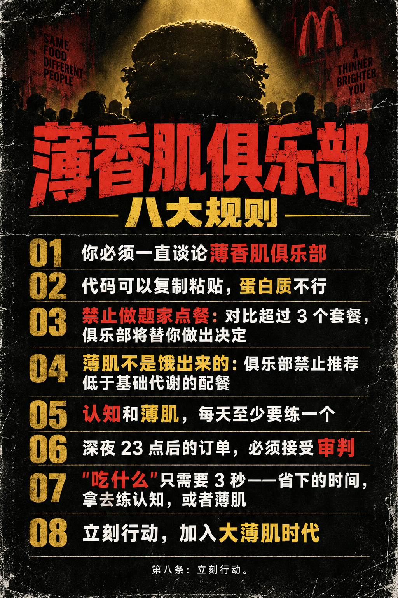

# 薄香肌俱乐部 · BoXiangJi Club

> 身体和认知，总要有一个先到达麦当劳。

薄肌俱乐部（麦门分部）—— 专为"只会做题不练腿"的程序员开设的麦当劳修行组织。
一个基于**麦当劳官方 MCP** 的 Agent Skill：用真实营养数据做配餐，用真实订单做复盘，用梗做信仰。

**麦当劳程序员创意开发大赛参赛作品。**

## 俱乐部八大规则



1. **你必须一直谈论薄香肌俱乐部。**
2. **代码可以复制粘贴，蛋白质不行。**
3. **禁止做题家点餐**：对比超过 3 个套餐，俱乐部将替你做出决定。
4. **薄肌不是饿出来的**：俱乐部禁止推荐低于基础代谢的配餐。
5. **认知和薄肌，每天至少要练一个。**
6. **深夜 23 点后的订单，必须接受审判。**
7. **"吃什么"只需要 3 秒——省下的时间，拿去练认知，或者练薄肌。**
8. **立刻行动，加入大薄肌时代。**

## 核心玩法

- **薄肌值**：你的身体管理怎么样（真实订单营养复盘 + 体测问卷）
- **认知值**：你的决策质量怎么样（点餐内耗检测、做题家行为审判）
- 双轴定段位：**做题家 → 觉醒者 → 薄肌信徒 → 薄肌大师 → 古希腊雕塑**

## 一句话安装

不用装任何东西。把这段话直接发给你的 Agent（Cursor / Claude Code / Trae / WorkBuddy / Cherry Studio 等任何支持 MCP 的都行）：

> 读取 https://github.com/<owner>/boxiangji-club 里的 SKILL.md，从现在开始按它扮演薄香肌俱乐部店长。然后按仓库里的 mcp-config.example.json 帮我配置麦当劳 MCP，Token 我会发给你。配好后跟我说：欢迎入会。

就这一句。Agent 会自己读懂规则、配好 MCP、完成入会仪式。

> 如果你用的是支持 [Agent Skills](https://agentskills.io) 标准的客户端，也可以 `npx skills add <owner>/boxiangji-club` 一键装进本机所有 Agent（Claude Code / Cursor / Codex / Trae / OpenCode / Gemini CLI 等 79+ 个）。

### 关于麦当劳 MCP Token

所有客户端通用同一段配置（见 [mcp-config.example.json](mcp-config.example.json)），正常情况 Agent 会帮你写好，无需手动操作：

```json
{
  "mcpServers": {
    "mcd-mcp": {
      "type": "streamablehttp",
      "url": "https://mcp.mcd.cn",
      "headers": { "Authorization": "Bearer ${MCD_MCP_TOKEN}" }
    }
  }
}
```

Token 申请：[open.mcd.cn/mcp](https://open.mcd.cn/mcp) 登录后在控制台"激活"即可。

**WorkBuddy 用户**：左侧边栏【专家·技能·连接器】→【连接器】→【自定义连接器】→【配置MCP】，粘贴上方 JSON（替换 Token），启用 `mcd-mcp`，然后把 `SKILL.md` 的内容作为技能导入即可。

## 五大部门

| 部门 | 干什么 |
|---|---|
| **入会审查处** | 双轴测评：问卷 + 历史订单复盘 → 薄肌值/认知值 → 段位认证卡 |
| **膳食修行部** | 三模式配餐：增肌 / 减脂 / debug 续命（夜间低升糖防困），真实菜单交叉验证 + 权威核价叠券 |
| **认知研究院** | 每日认知金句 × 真实活动日历（比如 9.9 元早餐两件套） |
| **纪律审判庭** | 做题家点餐审判（对比超 3 个套餐替你决策）、23 点后深夜订单审判、久坐拷打 |
| **传教事业部** | 一键生成入会认证卡 / 每日金句卡（SVG 分享图） |

## 使用示例

```
你：入会
店长：欢迎来到薄香肌俱乐部。先回答：你上次离开工位超过一小时是什么时候？
……（5 个问题 + 历史订单复盘）……
店长：判决如下——薄肌值 42，认知值 61，段位「觉醒者」。
     你的问题不是吃得多，是根本不知道自己在吃什么。认知尚可，薄肌堪忧。
     认证卡已生成，分享它，履行第一条。
```

```
你：帮我配个减脂餐，700 大卡以内，到店取，王府井
店长：（拉取营养库 160 项 × 王府井门店实时菜单 103 项，交叉验证，查券核价）
     配餐如下：双层吉士汉堡 + 薄皮焦香V翅，合计 621kcal / 蛋白质 44g / ¥38.5。
     你的肌肉在工位底下悄悄生长。是否下单？
```

## 项目结构

```
boxiangji-club/
├── SKILL.md                 # Agent Skill 主体（人格 + 五大工作流）
├── README.md
├── MCP_INTEGRATION.md       # MCP 工具映射与调用流程
├── CONTEST_DECLARATION.md   # 参赛声明
├── mcp-config.example.json  # MCP 配置示例（环境变量占位符）
├── references/              # 八大规则话术 / 认知金句库 / 配餐策略
├── assets/                  # 认证卡 / 金句卡 SVG 模板
└── examples/                # 真实对话示例
```

## 合规与免责

- 本项目为参赛独立开发作品，非麦当劳官方产品。
- 所有营养、价格、门店、优惠数据均实时来自麦当劳官方 MCP，项目不存储、不编造。
- 配餐建议仅供参考，不构成医疗或营养专业建议。
- 仓库不包含任何真实 Token，配置仅使用环境变量占位符。

## License

MIT
